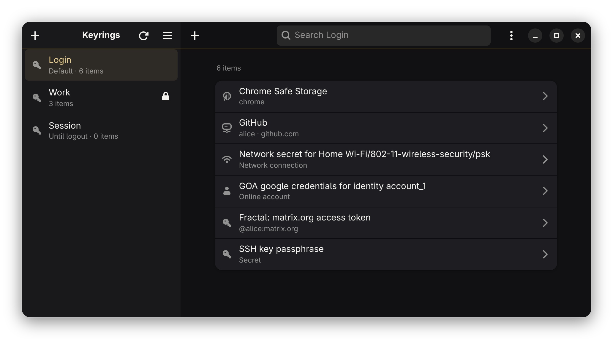

# Moneypenny

**Manage the passwords and secrets in your keyrings, the GNOME way.**

Moneypenny is a desktop app for browsing and editing the secrets that apps
store in your keyrings: Wi-Fi passwords, browser and chat logins, SSH key
passphrases, access tokens. It's built for
[oo7](https://github.com/linux-credentials/oo7), the Secret Service provider
that replaces gnome-keyring in Fedora 45, and works with any other Secret
Service too.

Moneypenny talks to `oo7-daemon` over the standard Secret Service D-Bus API,
using oo7's own Rust client library, so it sees exactly the keyrings every
other app on your system sees.

<p align="center">
  
</p>

> **0.1.0** is the first release, for Fedora 45 and later (x86_64).
> [Download the RPM](https://github.com/neuralpunk/Moneypenny/releases/latest).

## Features

- **Browse and search.** Keyrings in the sidebar, their secrets in a list,
  searchable by name or attribute (username, server, app, …).
- **Reveal or copy.** Show a secret on demand, or copy it without it ever
  being displayed. The clipboard is cleared after 15 seconds, and when
  Moneypenny quits, if it still holds the secret.
- **Edit.** Add, edit and delete secrets and their attributes; create, lock,
  unlock and delete keyrings; change a keyring's password.
- **Live.** Changes made by other apps show up immediately, and Moneypenny
  reconnects on its own if oo7-daemon restarts.
- **At home on GNOME.** An Adwaita layout that follows your dark/light style,
  high contrast, reduced motion and window-button layout, and adapts to
  narrow windows (down to 360 px).
- **Black Tie.** Deeper blacks, a champagne-gold accent and a hairline of gold
  under the header bars: a small nod to James Bond.
- **Keyboard first.** Every main action has a shortcut (see below).

## Install

Moneypenny is packaged as an RPM for **Fedora 45 and later** on x86_64.

1. Download `Moneypenny-0.1.0-1.x86_64.rpm` from the
   [latest release](https://github.com/neuralpunk/Moneypenny/releases/latest).
2. Optionally, check it: put `SHA256SUMS` from the same release next to it
   and run `sha256sum -c SHA256SUMS`.
3. Install it:

   ```sh
   sudo dnf install ./Moneypenny-0.1.0-1.x86_64.rpm
   ```

Moneypenny then appears in the GNOME app grid. To remove it:

```sh
sudo dnf remove moneypenny
```

The package depends on `webkit2gtk4.1` and `gtk3`, which dnf installs if
needed, and recommends `oo7-daemon`, Fedora 45's default keyring service.

## Using Moneypenny

- Pick a keyring in the sidebar to see its secrets. A **locked** keyring shows
  an *Unlock* button; your password goes into the system's own password
  dialog, never into Moneypenny.
- Select a secret to see its details and attributes. Use the eye button to
  reveal it, or the copy button to copy it.
- **+** above the secrets list adds a secret; **+** in the sidebar adds a
  keyring. The keyring menu (**⋯**) locks or unlocks a keyring, changes its
  password or deletes it.
- Deleting anything always asks first.

### Keyboard shortcuts

| Action | Shortcut |
|---|---|
| Search | <kbd>Ctrl</kbd>+<kbd>F</kbd> |
| Reload | <kbd>Ctrl</kbd>+<kbd>R</kbd> or <kbd>F5</kbd> |
| Go back | <kbd>Esc</kbd> or <kbd>Alt</kbd>+<kbd>←</kbd> |
| New secret | <kbd>Ctrl</kbd>+<kbd>N</kbd> |
| Copy secret | <kbd>Ctrl</kbd>+<kbd>C</kbd> |
| Edit secret | <kbd>Ctrl</kbd>+<kbd>E</kbd> |
| New keyring | <kbd>Ctrl</kbd>+<kbd>Shift</kbd>+<kbd>N</kbd> |
| Keyboard shortcuts | <kbd>Ctrl</kbd>+<kbd>?</kbd> |
| Quit | <kbd>Ctrl</kbd>+<kbd>Q</kbd> |

## Security

Moneypenny is a window onto your keyrings, so it's careful with them:

- **It never sees your keyring passwords.** Unlocking, creating a keyring and
  changing its password all use the password dialog shown by oo7-daemon
  (GNOME Shell's own dialog on GNOME).
- **Secrets are fetched only when you reveal or copy them**, and are never
  cached. A revealed secret is forgotten when you hide it or move on.
- **Copying happens in Rust**, through GTK's clipboard, so the secret is never
  sent to the app's web view. The clipboard is cleared after 15 seconds, or on
  quit, but only if it still holds that secret.
- **Secret text is zeroized** in memory when dropped and redacted from logs.
- **Nothing is replaced by accident.** A new secret never overwrites an
  existing one, and every deletion is confirmed.
- No network access: Moneypenny only talks to the Secret Service on your
  session bus.

Found a security problem? Please open an
[issue](https://github.com/neuralpunk/Moneypenny/issues) without the details
and ask for a private channel.

## Troubleshooting

**"Can't Reach the Keyring Service"**: Moneypenny couldn't find a Secret
Service on the session bus. Check that oo7-daemon is running:

```sh
systemctl --user status oo7-daemon
```

**A keyring shows no secrets until unlocked**: that's oo7-daemon's design; it
hides a locked keyring's item names and attributes, not only the secrets.

**Unlocking accepts any password**: oo7-daemon does this for an *empty*
keyring, since there's nothing encrypted to check the password against.

## Known limitations

- Choosing the default keyring isn't offered yet: oo7-daemon 0.7 doesn't save
  that choice, so it would quietly revert at the next login.
- Binary (non-text) secrets show their size but can't be revealed or copied.
- Packages are RPM-only, built for Fedora 45 and later on x86_64. Other
  distributions can build from source.

## Build from source

You need Rust ≥ 1.95, Node ≥ 20, pnpm, and the WebKitGTK headers
(`webkit2gtk4.1-devel` on Fedora).

```sh
pnpm install
pnpm tauri build
sudo dnf install ./src-tauri/target/release/bundle/rpm/Moneypenny-0.1.0-1.x86_64.rpm
```

## Development

```sh
pnpm install
pnpm tauri dev      # run the app with hot reload
pnpm check          # Svelte/TypeScript type check
pnpm test           # frontend unit tests (Vitest)
cd src-tauri && cargo test && cargo clippy --all-targets -- -D warnings
cargo run --example smoke   # read-only check of your real keyring (names/counts only)
```

The integration tests in `src-tauri/tests/` start their own private D-Bus bus
and `oo7-daemon` in a temporary directory, so they never read or modify your
real keyring. They need `dbus-daemon` and `/usr/libexec/oo7-daemon` (override
with `OO7_DAEMON=/path/to/oo7-daemon`), and are skipped if oo7-daemon is
missing.

`pnpm dev` on its own serves the UI in a browser for quick layout work, with
sample keyrings (`src/lib/mock.ts`, excluded from production builds). With no
portal there, it falls back to the browser's light/dark preference.

### Project layout

| Path | What's there |
|---|---|
| `src-tauri/src/keyring.rs` | Secret Service client on `oo7::dbus`: keyrings, items, secrets, prompts |
| `src-tauri/src/watch.rs` | Live updates from Secret Service signals |
| `src-tauri/src/clipboard.rs` | Copy through GTK and the timed clear |
| `src-tauri/src/desktop.rs` | GNOME settings from the XDG portal (style, contrast, button layout) |
| `src/lib/` | Svelte 5 UI: libadwaita-style components, views, state |
| `packaging/` | Desktop entry template and AppStream metainfo |
| `docs/PLAN.md` | How it was built: decisions, oo7 quirks, follow-ups |

**Stack:** Tauri 2 · Svelte 5 · Tailwind CSS 4 · `oo7` · `ashpd`

## Contributing

Bug reports and ideas are welcome in
[issues](https://github.com/neuralpunk/Moneypenny/issues). Changes between
releases are in [CHANGELOG.md](CHANGELOG.md).

## License

GPL-3.0-or-later. See [LICENSE](LICENSE).

## Credits

Symbolic icons in `src/lib/icons/` are from the GNOME
[Adwaita icon theme](https://gitlab.gnome.org/GNOME/adwaita-icon-theme),
licensed LGPL-3.0-only or CC-BY-SA-3.0. Moneypenny is built on
[oo7](https://github.com/linux-credentials/oo7) by the linux-credentials
project, and isn't affiliated with it.
